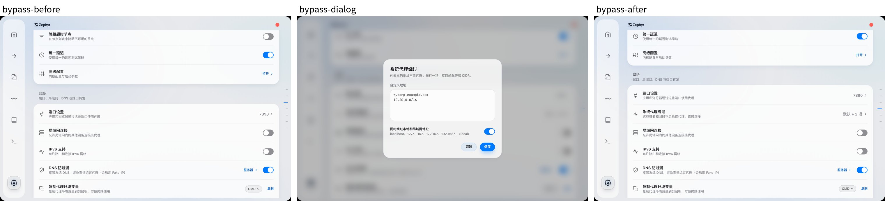
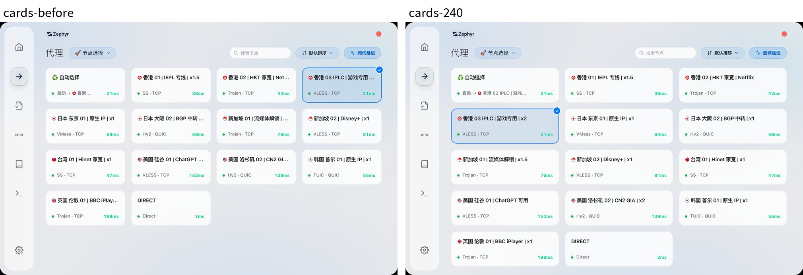
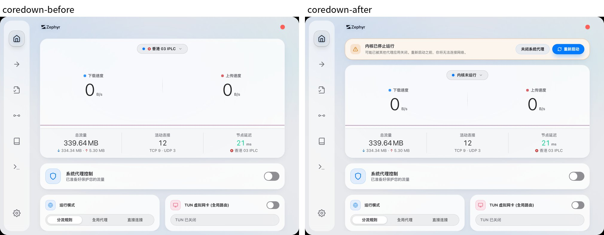
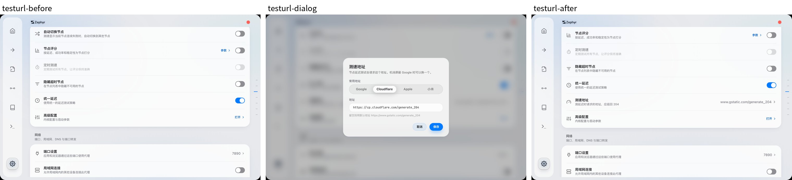
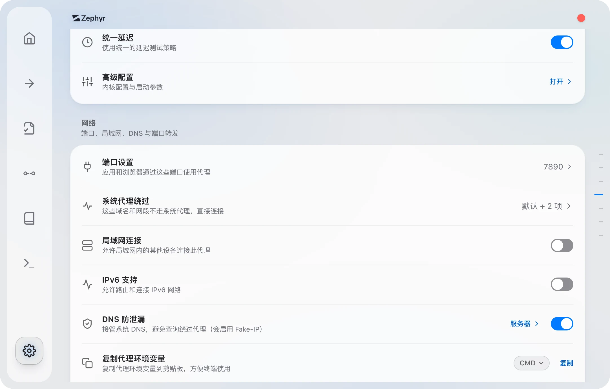
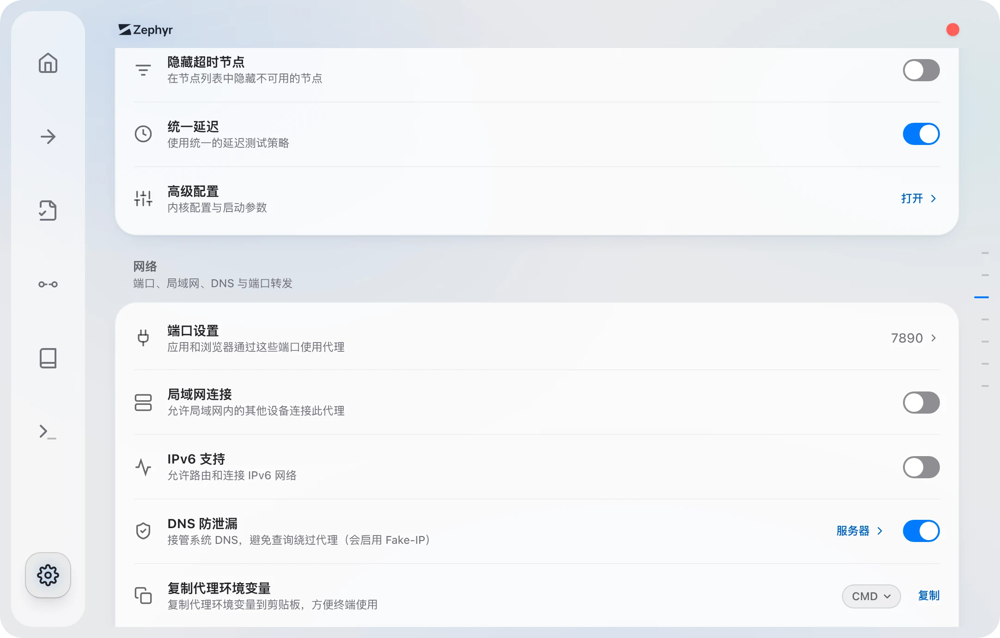
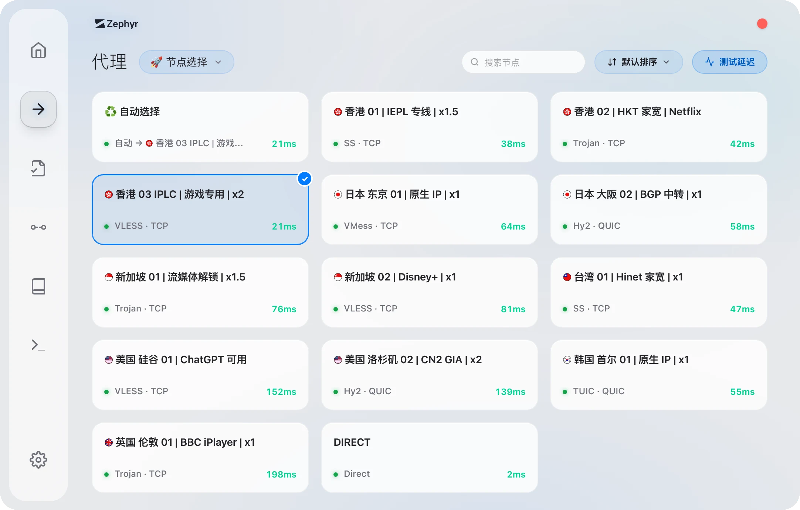
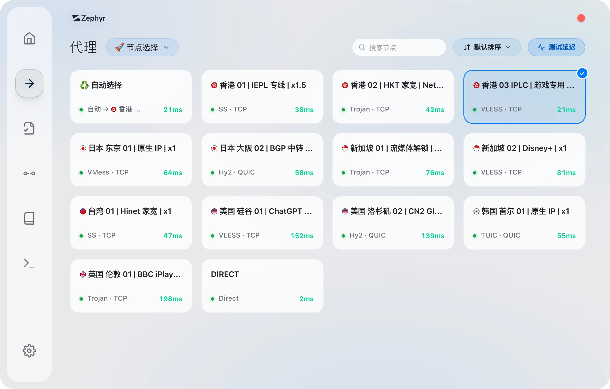
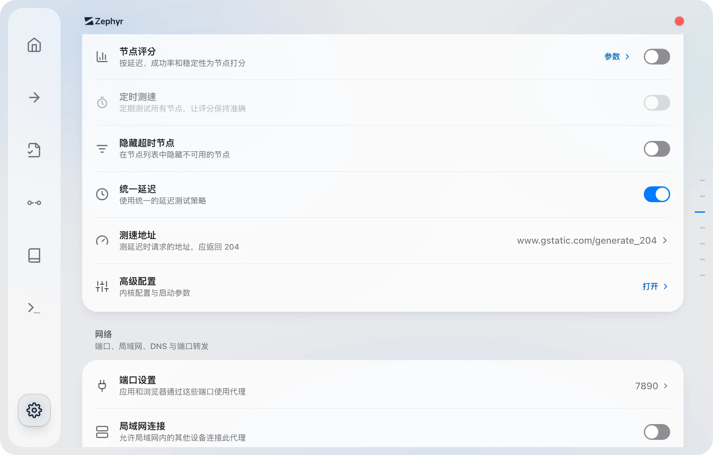
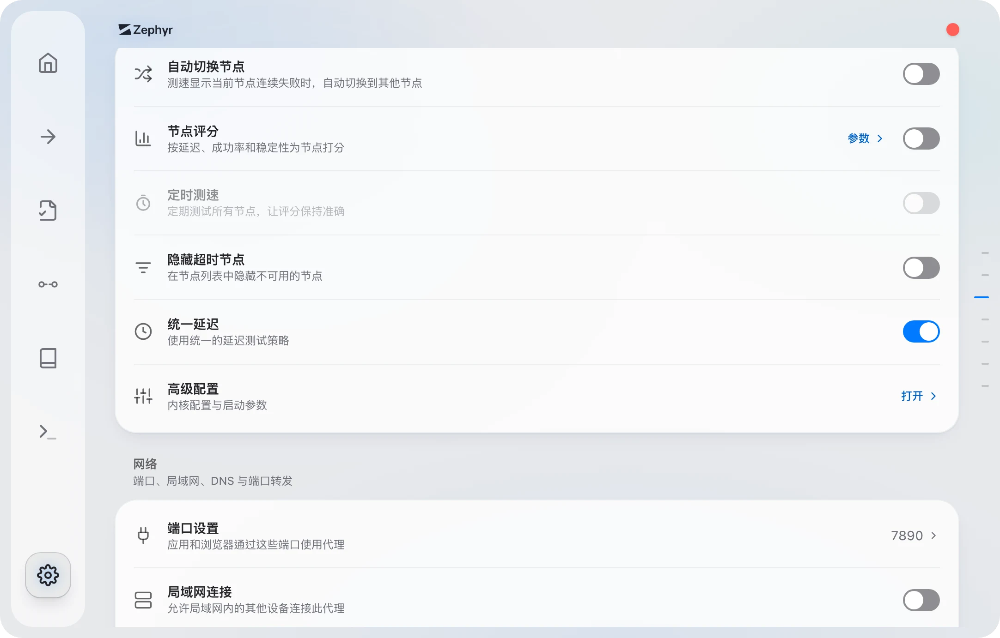

# early-prototypes

最早一批建议原型（`?proto=<name>`）的截图和拼图。

共 7 张。

### bypass.jpg

### cards.jpg

### coredown.jpg

### corners.jpg

### exitip.jpg

### home.jpg

### testurl.jpg

## snap/

### snap/bypass-after.webp

### snap/bypass-before.webp

### snap/bypass-dialog.webp

### snap/cards-240.webp

### snap/cards-before.webp

### snap/coredown-after.webp

### snap/coredown-before.webp

### snap/corners-after.webp

### snap/corners-before.webp

### snap/exitip-before.webp

### snap/exitip-done.webp

### snap/exitip-idle.webp

### snap/home-a-open.webp

### snap/home-a.webp

### snap/home-b-open.webp

### snap/home-b.webp

### snap/home-before.webp

### snap/testurl-after.webp

### snap/testurl-before.webp

### snap/testurl-dialog.webp

