# look-crops

看图检查时裁出来的局部放大图。

共 23 张。

### cA.jpg

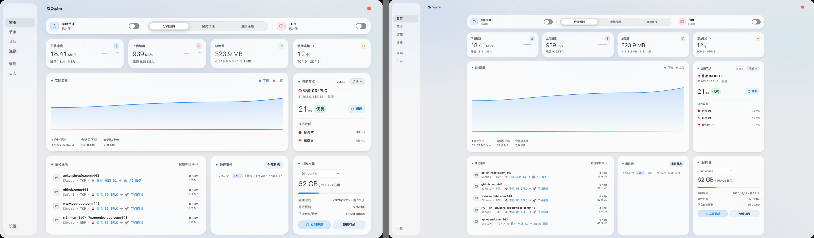

### cB.jpg

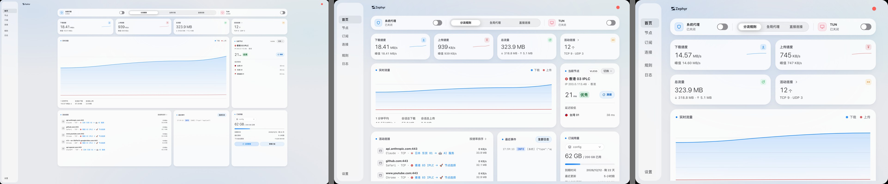

### cur-side.webp

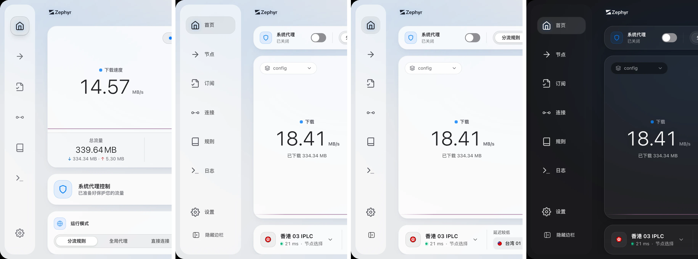

### h1000x1200.jpg

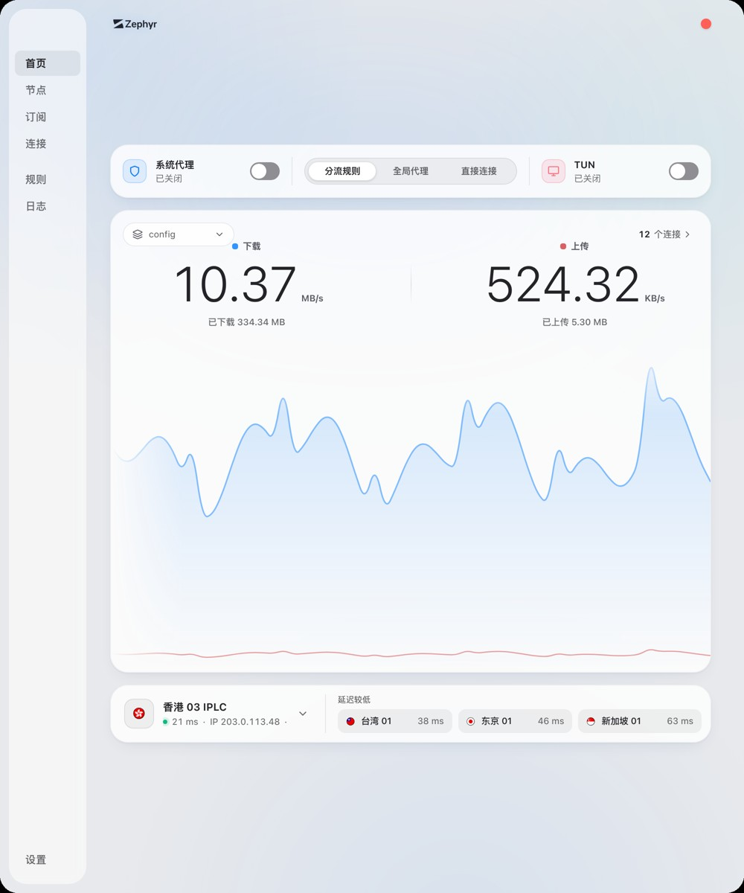

### h1440.jpg

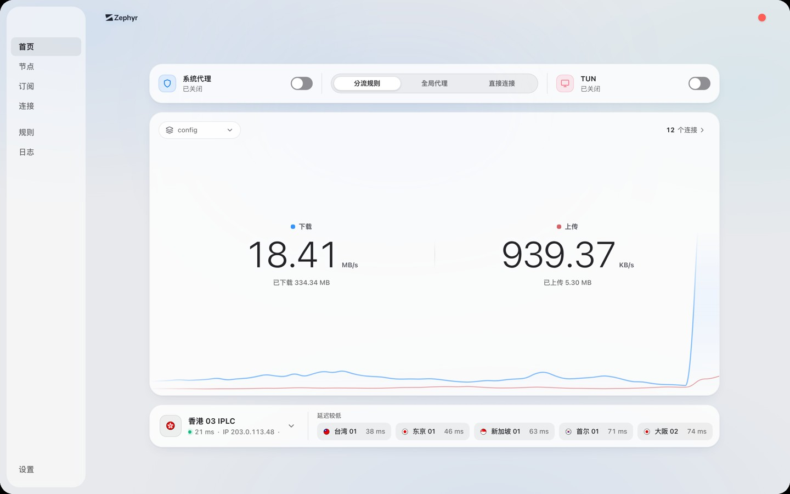

### h720x540.jpg

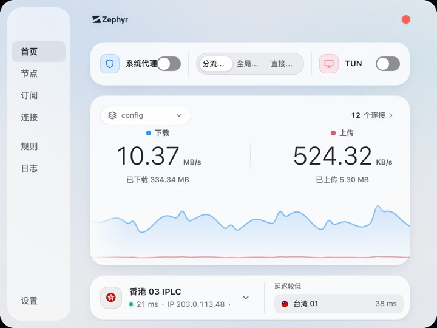

### hA.jpg

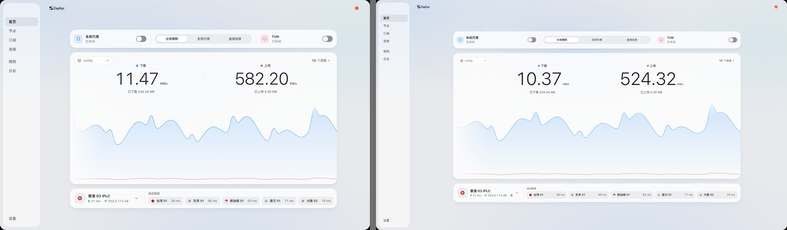

### hB.jpg

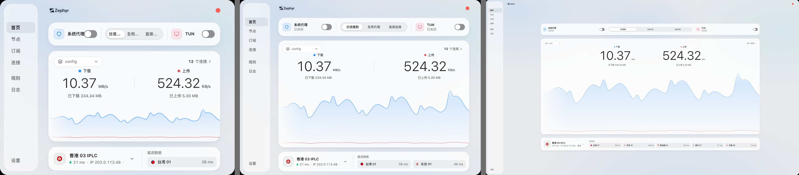

### hC.jpg

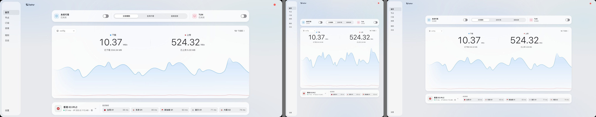

### hdr-new.jpg

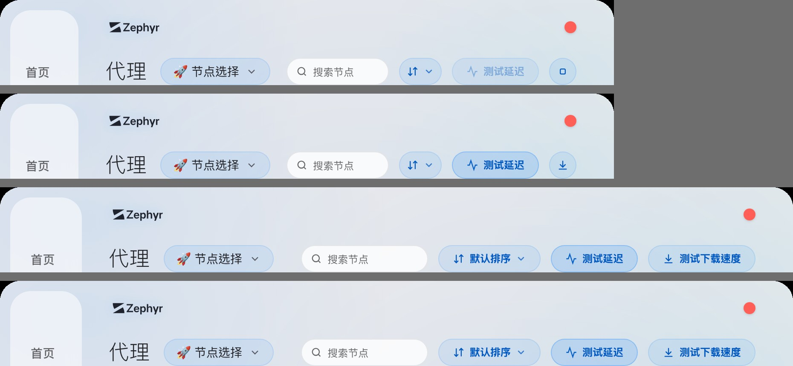

### hdr-prev.jpg

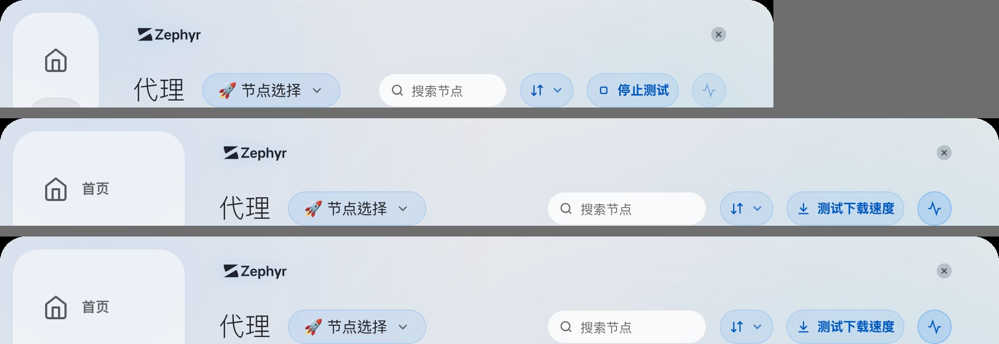

### s1.jpg

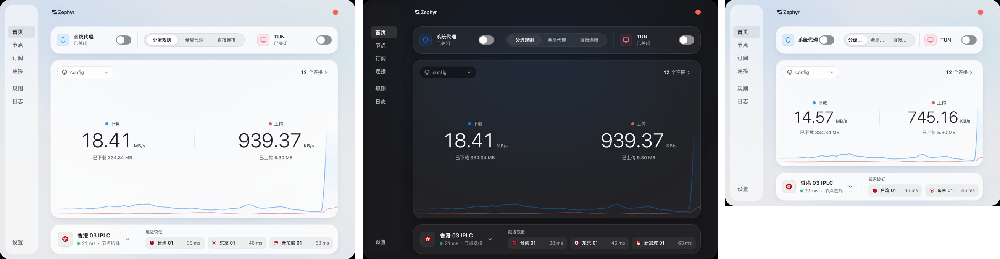

### s2.jpg

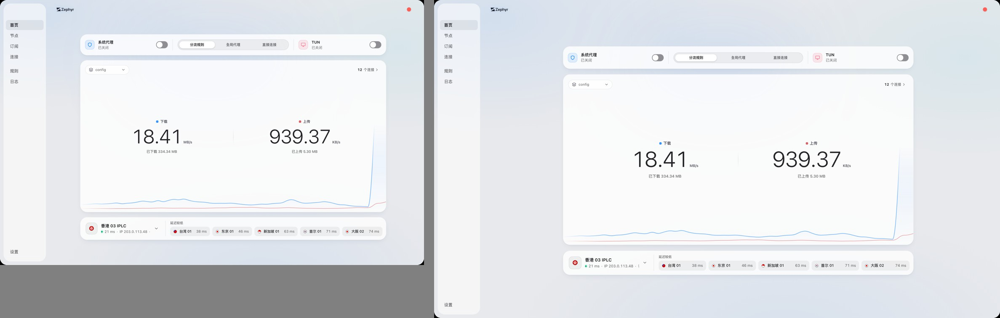

### s3.jpg

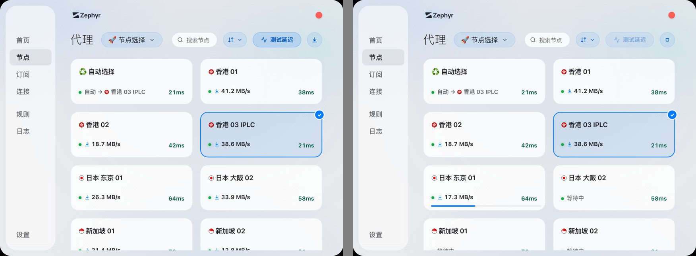

### s4.jpg

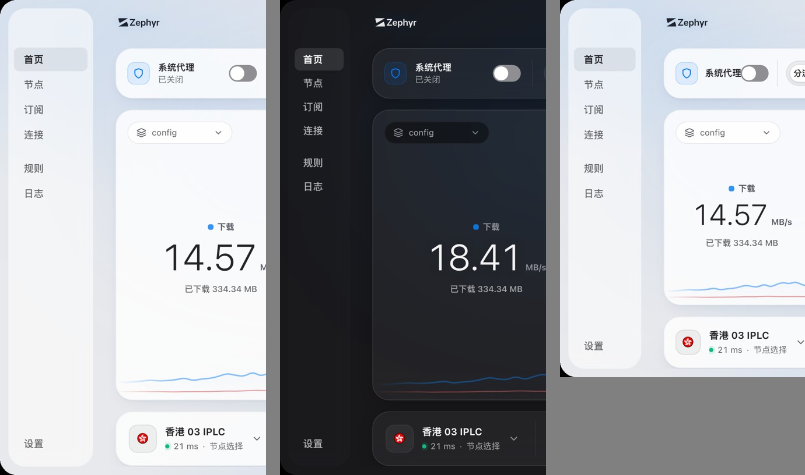

### s5.jpg

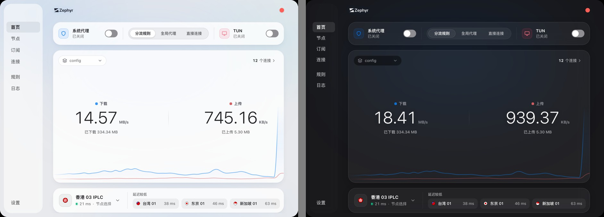

### sd.jpg

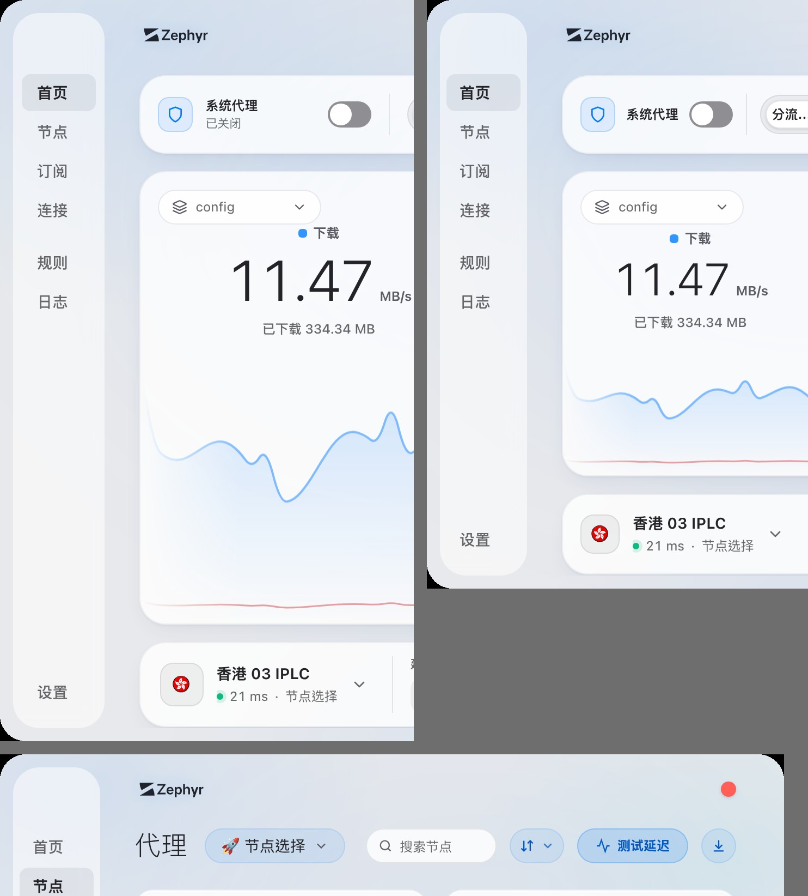

### v1.jpg

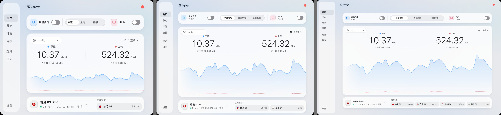

### v2.jpg

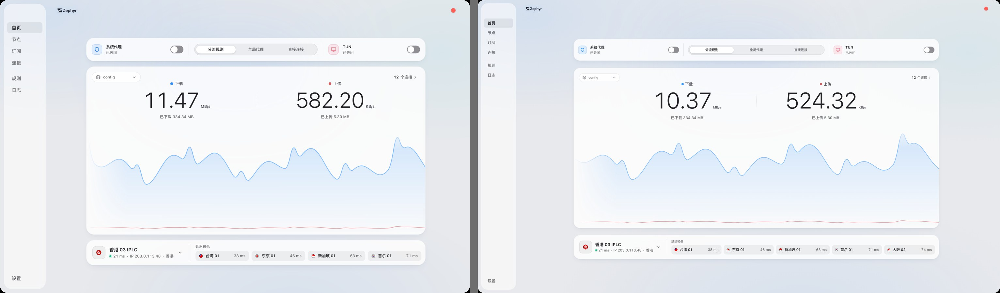

### v3.jpg

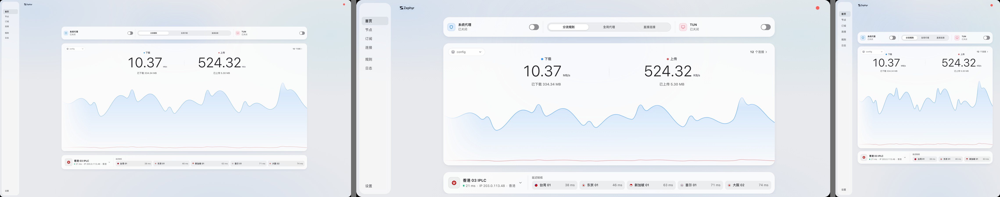

### v4.jpg

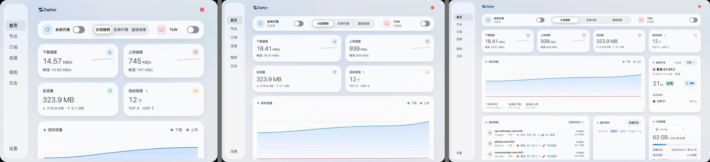

### v5.jpg

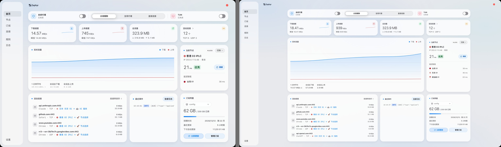

### v6.jpg

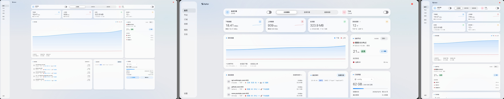
