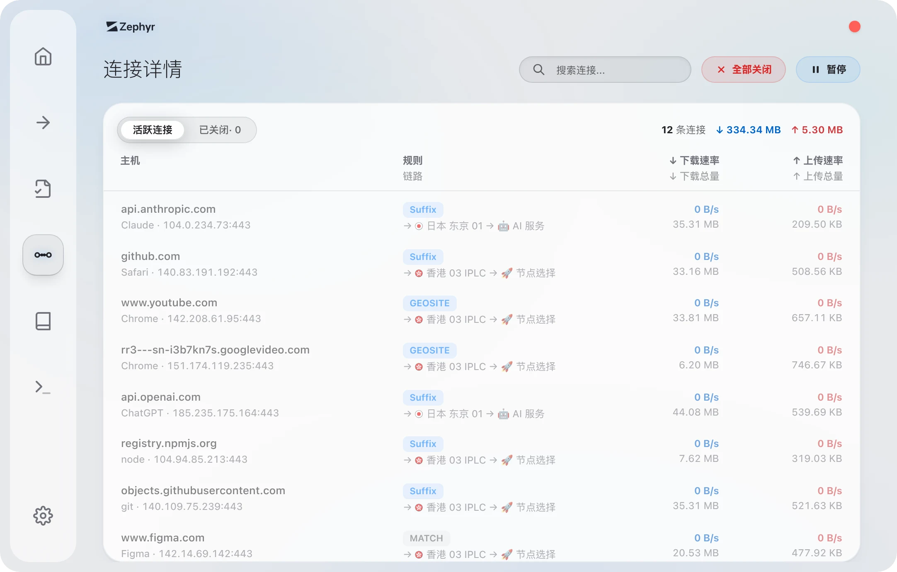
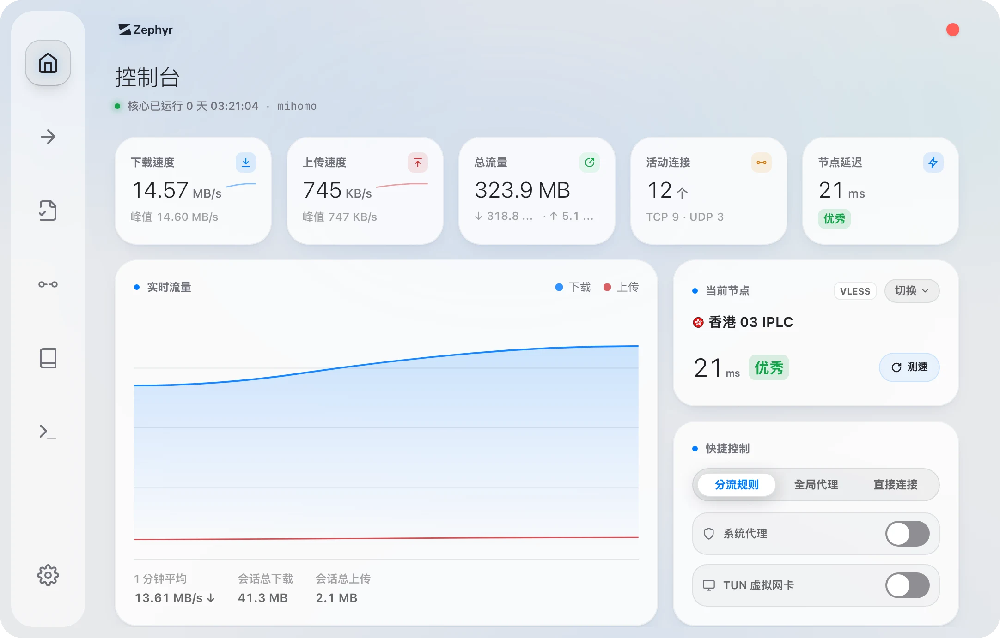
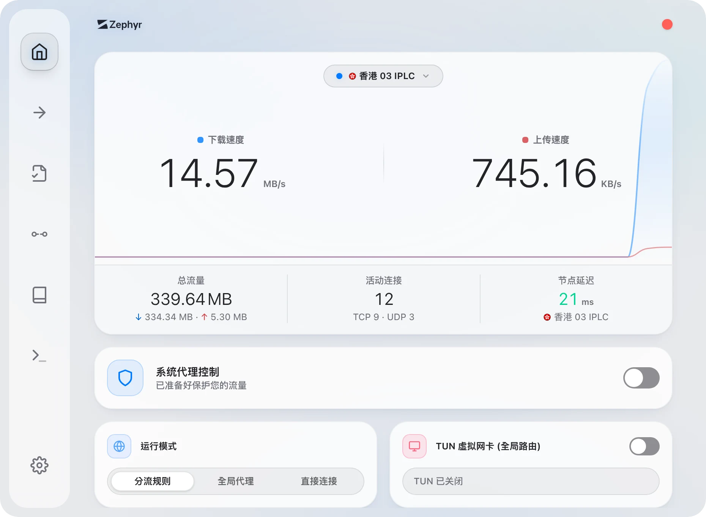
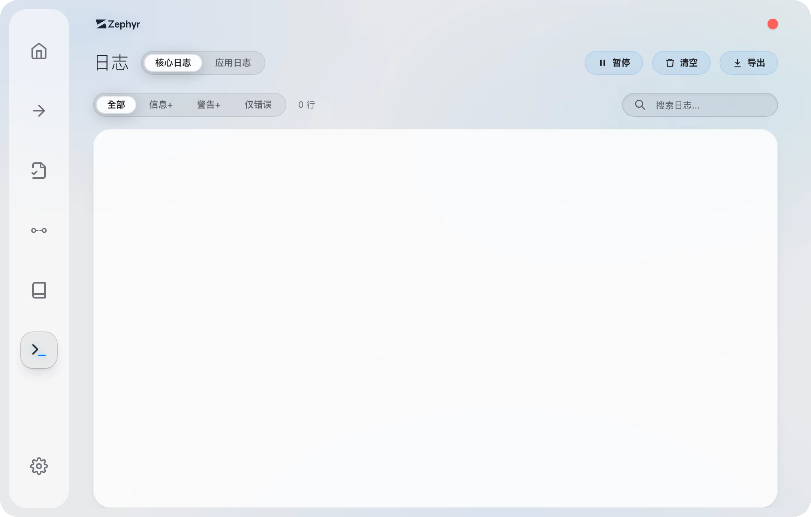
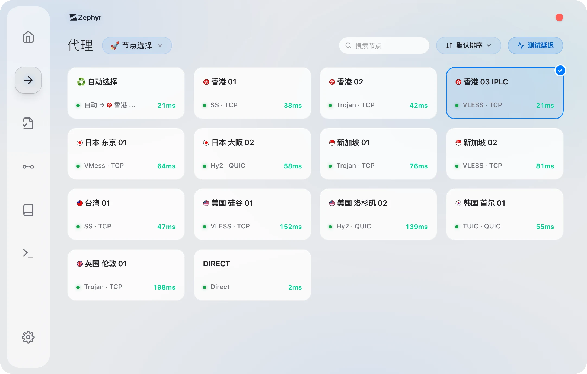
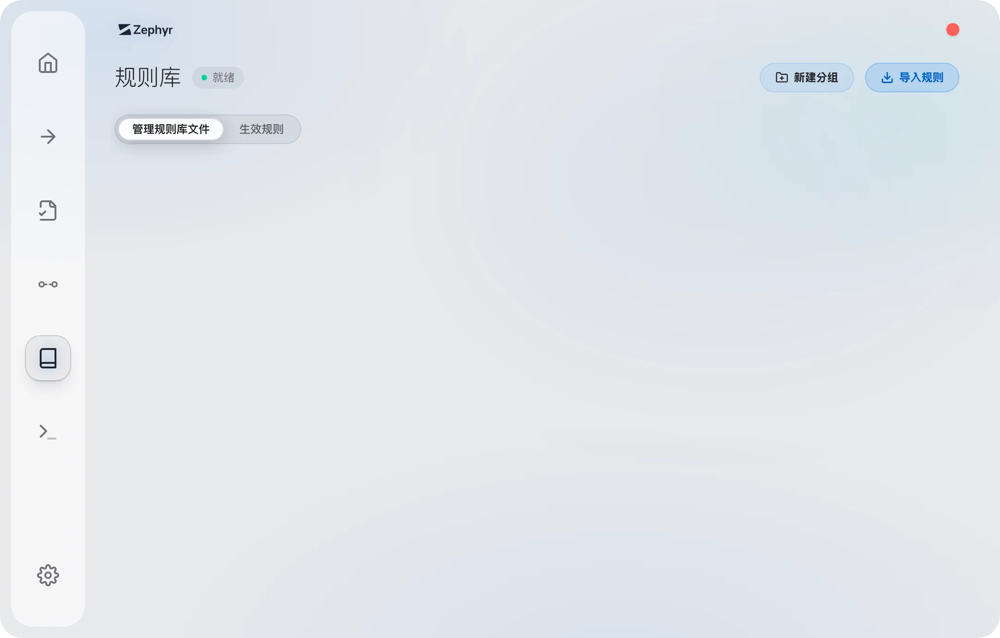
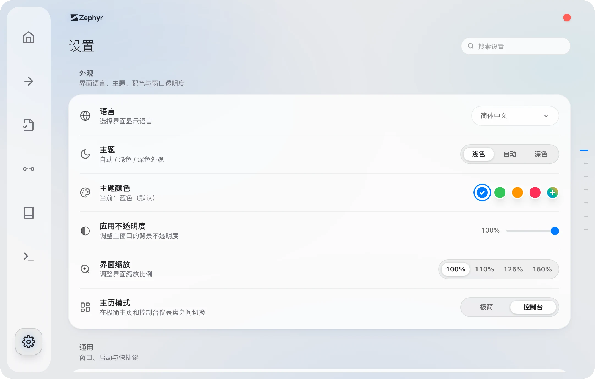
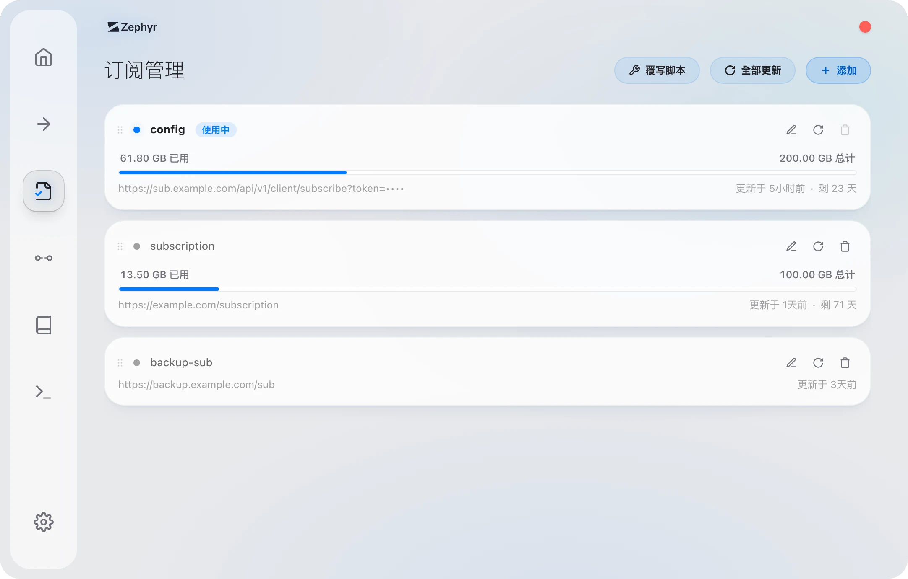

# main-baseline

main 原样截图，作为基线。

共 8 张。

### connections.webp

### console.webp

### home.webp

### logs.webp

### proxies.webp

### rule-library.webp

### settings.webp

### subscriptions.webp

