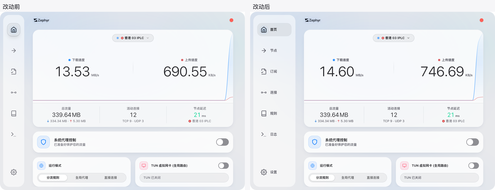
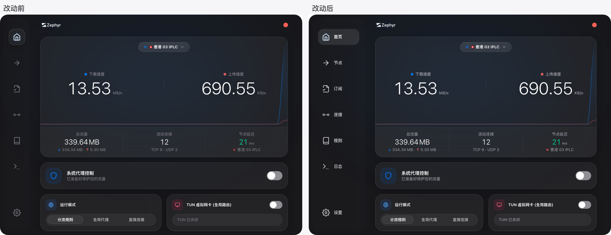
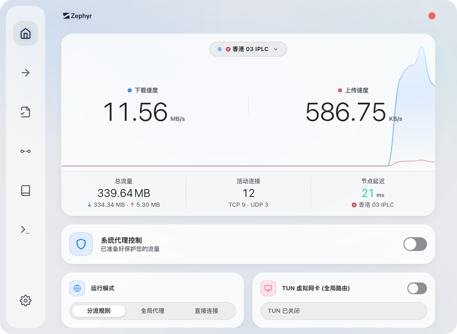
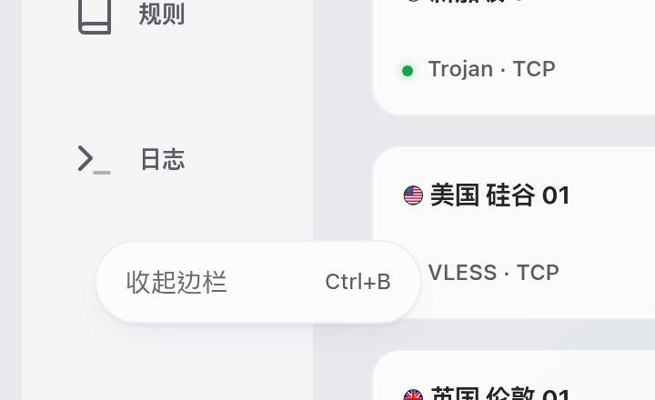
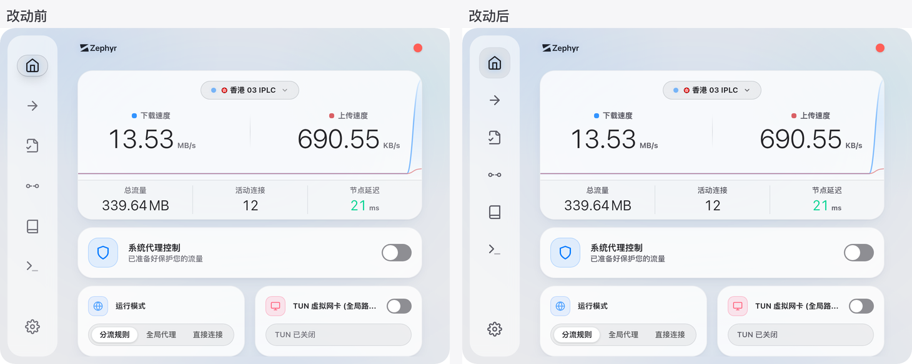
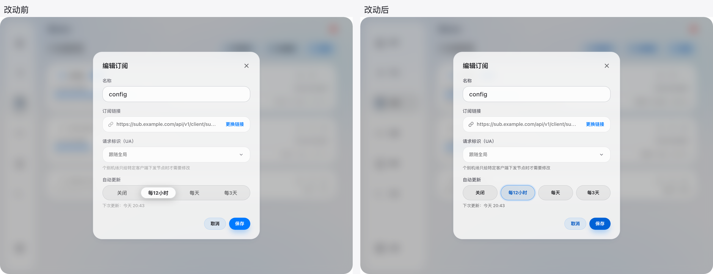
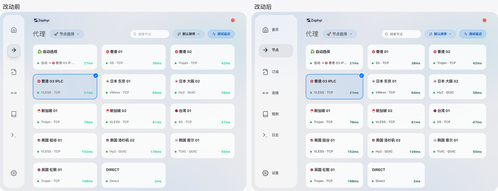

把这次 UI 评审定下来的部分改进真实的组件和样式：侧栏、文字对比度、选择卡片和节点卡片。只改桌面端前端和设计 token，没有改 Rust 代码。

## 侧栏：原来的图标加名字，能展开收起，但不加按钮

- 保留原来的图标，每个图标旁边加一个短名字：首页、节点、订阅、连接、规则、日志、设置。新增 `navProxies`、`navSubscriptions`、`navConnections`、`navRules` 四个短名字（14 种语言都有），页面标题沿用原来的长名字。
- 中日韩的名字是两个字，展开宽度 160 px；其他语言加宽到 192 px，实测 "Subscriptions"、"Connections" 不会被截断。
- **展开和收起不加任何按钮**，用桌面应用常见的四种方式：
  - 拖侧栏右边缘：鼠标移上去会出现一条蓝色细线，往左拖收起、往右拖展开，松手时吸到更近的状态；双击也能切换。从右到左的语言里方向反过来。
  - 快捷键：macOS 上是 ⌃⌘S（参照 macOS 应用菜单里标准的「显示/隐藏边栏」），Windows 和 Linux 上是 Ctrl+B。焦点在输入框或编辑器里、或者有弹窗开着时不响应，留给编辑器自己的快捷键（比如插件编辑器的保存）。
  - 右键侧栏：菜单里只有一项「收起边栏」或「展开边栏」，右边写着快捷键。
  - 窗口窄于 860 px 时自动收起（按界面缩放后的宽度算，改缩放比例也会重新判断）。这时再展开，侧栏盖在内容上面，不挤压内容；点一个页面、点侧栏外面或按 Esc 就收回去。
- 侧栏状态在启动时就恢复，不会等内核启动完才突然展开。宽窗口里展开还是收起会记住（`localStorage`）。窄窗口的自动收起和临时展开不会覆盖这个选择，窗口拉宽后恢复。
- 展开和收起时图标位置不动，只有侧栏宽度变化。名字只裁剪不换行；展开时先变宽、名字晚 80 ms 淡入，收起时名字先淡出。系统打开「减少动态效果」时不做宽度动画。
- 展开后名字已经显示出来，悬停提示只在名字被截断时才出现；收起时和原来一样。
- 选中项改成平铺的浅底色，和 macOS 系统设置、访达的侧栏一样，不再像一个浮起的盒子。深色模式下没选中的项原来偏暗，提亮了。
- 不加「隐藏边栏」一类的图标按钮，也不换图标、不把名字放到图标下面。

默认窗口（930×680），浅色和深色：

收起后（Ctrl+B）和右键菜单：

720×540 窗口自动收起：

## 文字对比度达到 WCAG AA（小字 4.5:1）

- 浅色模式：三级文字 0.4 → 0.64，`--zephyr-text-muted` #71717a → #5b5b65。深色模式：三级文字 0.4 → 0.52，muted → #8e8e98。改在 `packages/tokens/src/semantic.json`，`build/css/variables.css` 是重新生成的。
- 主按钮蓝底 #007AFF → #0062D6（白字从 4.0:1 到 5.6:1），浅底上的蓝字用 #0058C2；深色模式蓝字 #4DA3FF、红字 #F87171。
- 品牌蓝 #007AFF 仍然用在图标、滑块和选中描边上，只有字和白字下面的蓝底加深一档，和 macOS「增强对比度」的做法一样。

## 选择卡片（新组件）

- 新增通用的 `.choice-card` / `.choice-grid`，写在 `styles.css`。规则：**4 个及以上选项的单选用选择卡片，2–3 个选项继续用分段控件（`.seg-tabs`）**。
- 订阅编辑弹窗的「自动更新」有 4 个预设，改用选择卡片。原来分段控件里选中的一项和没选中的几乎分不出来。仍然是 `role="radiogroup"` / `role="radio"`，键盘操作和保存逻辑没变。导出日志的「导出内容」（3 个）和外观的「主页模式」（2 个）保持分段控件。

## 节点卡片

- 最小宽度 180 → 200 px，长节点名和延迟能放在同一行。
- 只在悬停时出现的重新测试按钮，平时看不见却一直占着 20 px，把副标题挤成「自动 → 香港 03 IP…」。现在它平时不占位置，悬停、键盘聚焦和测试中照常显示；触屏设备上一直显示，和原来一样。

## 测试

- 新增 `apps/desktop/src/ui/sidebar.test.js`（13 个）：快捷键在 macOS 和其他平台的判断、拖动松手时吸附、记住和恢复选择、窄窗口自动收起与恢复、窄窗口里的覆盖展开不写入记忆并能用 Esc 收回、双击边缘、右键菜单、输入框和弹窗里不拦截快捷键、按界面缩放后的宽度判断窄窗口。
- 本地跑过 eslint、类型检查、i18n 检查（0 个问题）、前端测试（99 个文件、1677 个测试），以及 pre-commit 和 pre-push 钩子（cargo clippy、cargo test、pnpm test）。
- 截图是用演示用的模拟接口在浏览器里跑应用拍的，左边是 main，右边是这个分支。用脚本量过 930×680（浅色和深色）、720×540、1440×900 下中文和英文侧栏的位置：展开时名字都没有被截断，导航按钮之间没有重叠，收起后图标的横坐标和展开时一样。

## 这个 PR 没有包含的

定稿里还有几项要改功能或整页重排，不适合和这次的样式改动放在一起，之后单独开 PR：

- 简洁首页和控制台首页的重新排版（当前节点条和「延迟较低」、流量卡精简、随窗口尺寸缩放的规则、控制台 4 列网格）。
- 节点一键下载测速，以及「测试延迟」在前、空间不够先收起「测试下载速度」的按钮顺序（需要后端支持）。
- 延迟测试地址设置和它的选择卡片弹窗、连接页直接改规则、自动查询 IP 地址的开关、内核停止横幅。
